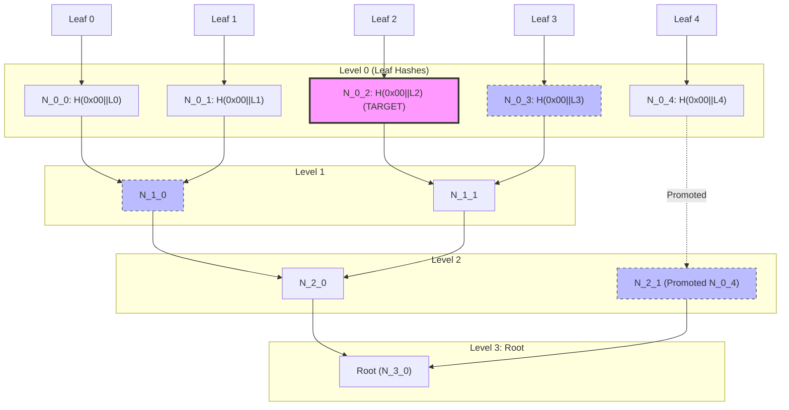

# Assignment 2: Merkle Trees and Proofs of Inclusion (`merkle`)

**Course**: Practical Blockchain Engineering (Dr. Mayank Agarwal, IIT Patna)  
**Student Name**: Navaneeth Nalla  
**Student Roll**: `2301AI14`  
**Webmail**: `navaneeth_2301ai14@iitp.ac.in`  
**Package**: `merkle`  

---

## 1. Overview & Purpose

A Merkle tree is an authenticated cryptographic data structure allowing a logarithmic-sized proof ($O(\log N)$) to prove inclusion of any transaction in a committed set of $N$ transactions. 

This assignment implements a standalone Merkle tree library and CLI without external Merkle packages. It features:
- **Domain-separated cryptographic hashing** to defeat second-preimage attacks.
- **Unambiguous odd-leaf promotion rule** that avoids Bitcoin's duplicate-leaf vulnerability (CVE-2012-2459).
- **Canonical JSON proof generation and independent verification**.
- **Strict verification** rejecting malformed hashes, invalid traversal directions, out-of-bounds indices, and truncated/bloated sibling arrays.
- **High-performance scaling** tested up to 100,000 leaves.

---

## 2. Cryptographic & Topological Specification

### A. Domain Separation
To prevent second-preimage attacks where an internal node (64 bytes) is presented as a leaf:
- **Leaf Hash**:
  $$H_{\text{leaf}} = \text{SHA-256}(0\text{x}00 \parallel \text{data})$$
- **Internal Node Hash**:
  $$H_{\text{node}} = \text{SHA-256}(0\text{x}01 \parallel \text{left\_hash} \parallel \text{right\_hash})$$
The prefix bytes (`0x00` and `0x01`) guarantee that no valid leaf hash can ever collide with or be misinterpreted as an internal node hash.

### B. Odd-Leaf and Zero-Leaf Rules
1. **Zero Leaves ($N = 0$)**:
   $$\text{Root} = \text{SHA-256}(b"") = \text{e3b0c44298fc1c149afbf4c8996fb92427ae41e4649b934ca495991b7852b855}$$
2. **Single Leaf ($N = 1$)**:
   $$\text{Root} = H_{\text{leaf}}(\text{leaf}_0)$$
   Proof requires 0 siblings.
3. **Odd Node Promotion**:
   If a tree level has an odd number of nodes $(2k + 1)$:
   - The first $2k$ nodes are paired: $(N_{2i}, N_{2i+1}) \to H_{\text{node}}(N_{2i}, N_{2i+1})$.
   - The unpartnered node $N_{2k}$ is **promoted directly to the next level** unchanged without re-hashing or duplication.
   *Security Rationale*: Duplicating the odd leaf (as done in Bitcoin `H(N || N)`) introduces malleability and fake-depth vulnerabilities (CVE-2012-2459). Promoting the odd node preserves strict cryptographic balance and deterministic uniqueness.

---

## 3. Five-Transaction Proof Path Diagram (`leaf_index: 2`)

Below is the exact tree structure and authentication path for 5 transactions ($L_0, L_1, L_2, L_3, L_4$) proving inclusion of **Leaf 2** ($L_2$):

```
                       Level 3: Root [N_3_0]
                              /        \
                             /          \
                Level 2: [N_2_0]      [N_2_1] (Promoted N_1_2)
                        /      \           |
                       /        \          |
          Level 1: [N_1_0]    [N_1_1]   [N_1_2] (Promoted N_0_4)
                   /    \     /     \      |
                  /      \   /       \     |
     Level 0:  N_0_0   N_0_1 N_0_2  N_0_3 N_0_4
                 |       |     |      |     |
     Leaves:    L_0     L_1   L_2    L_3   L_4
                               ^
                          Target Leaf
```

### Authentication Path for $L_2$ (`leaf_index: 2`):
1. Compute starting hash: $H_0 = H_{\text{leaf}}(L_2) = N_{0,2}$.
2. **Step 1 (Level 0)**: Sibling is $N_{0,3}$ on the **right**:
   $$H_1 = H_{\text{node}}(H_0 \parallel N_{0,3}) = N_{1,1}$$
   Proof element: `{"side": "right", "hash": N_0_3}`
3. **Step 2 (Level 1)**: Sibling is $N_{1,0}$ on the **left**:
   $$H_2 = H_{\text{node}}(N_{1,0} \parallel H_1) = N_{2,0}$$
   Proof element: `{"side": "left", "hash": N_1_0}`
4. **Step 3 (Level 2)**: Sibling is $N_{2,1}$ (which is promoted $N_{0,4}$) on the **right**:
   $$H_3 = H_{\text{node}}(H_2 \parallel N_{2,1}) = N_{3,0} = \text{Root}$$
   Proof element: `{"side": "right", "hash": N_2_1}`

### Mermaid Representation


---

## 4. Benchmark Performance Report

Benchmarked on local x86_64 CPU:

| Leaf Count ($N$) | Tree Construction Time (s) | Sibling Proof Length | Serialized Proof Size (JSON bytes) |
|---|---|---|---|
| **8** | 0.000052 s | 3 siblings | 331 bytes |
| **1,024** | 0.001364 s | 10 siblings | 1,001 bytes |
| **100,000** | 0.125469 s | 17 siblings | 1,665 bytes |

*Observations*:
- Construction exhibits strict $O(N)$ linear time scaling (100,000 transactions processed in ~0.12 seconds).
- Proof size scales logarithmically: $\lceil \log_2(100,000) \rceil = 17$ hashes, fitting inside a single 1.6 KB UDP/TCP datagram.

---

## 5. CLI Usage Examples

### 1. Calculate Root
```bash
merkle root "tx1" "tx2" "tx3" "tx4" "tx5"
# Or from file:
merkle root --file leaves.txt
```
**Output:**
```
tree_size: 5
root: c89ddf3c95e1e5ea01ff0fbe3aa70183eeeaee1bf6114eb31d6f30e6a88b56d3
```

### 2. Generate Inclusion Proof
```bash
merkle prove --index 2 "tx1" "tx2" "tx3" "tx4" "tx5" --out proof.json
```
**Sample Output (`proof.json`):**
```json
{
  "leaf_index": 2,
  "tree_size": 5,
  "siblings": [
    {
      "side": "right",
      "hash": "c0747cb90f3cfcb9aef5aa7eeb8fa6aa2b4c1aa564b71eeef84c71e8c75ff3ea"
    },
    {
      "side": "left",
      "hash": "eec7e8d6411516f0f7f329e46a166cb8da7df4a3e7e22137cfab7efb7ef0adfa"
    },
    {
      "side": "right",
      "hash": "a4d385f0b5d98dcbe7c222ffda583beff5204437a346eefaa1e3eb86f7b1dbf2"
    }
  ]
}
```

### 3. Verify Inclusion Proof
```bash
merkle verify --leaf "tx3" --proof proof.json --root "c89ddf3c95e1e5ea01ff0fbe3aa70183eeeaee1bf6114eb31d6f30e6a88b56d3"
```
**Output:**
```
VERIFICATION SUCCESS: Leaf is authentically included in the Merkle root.
```

---

## 6. Running Tests

Run the complete test suite:
```bash
pytest -v
```
All 25 tests pass covering domain separation, power-of-2 boundaries, odd promotions, proof verification across diverse sizes, and strict rejection of tampered proofs.

