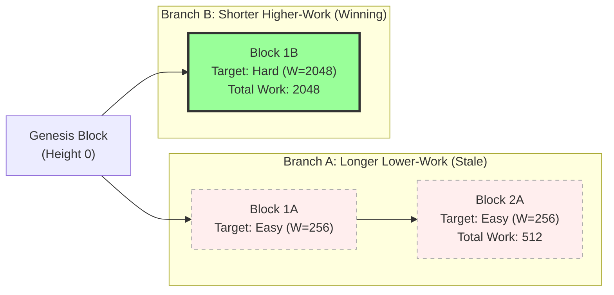

# Assignment 5: Blocks, Proof of Work, Forks, and Reorganisation (`chain`)

**Course**: Practical Blockchain Engineering (Dr. Mayank Agarwal, IIT Patna)  
**Student Name**: Navaneeth Nalla  
**Student Roll**: `2301AI14`  
**Webmail**: `navaneeth_2301ai14@iitp.ac.in`  
**Package**: `chain`  

---

## 1. Overview & Purpose

Proof-of-Work (PoW) consensus enables distributed nodes to agree on a single canonical timeline of state transitions in an adversarial, asynchronous network. Rather than relying on trusted coordinators or block height, nodes follow the **Most Cumulative Work Rule** (Nakamoto Consensus).

This assignment integrates the UTXO ledger from Assignment 4 and Merkle trees from Assignment 2 into a complete blockchain engine featuring:
- Deterministic 116-byte binary block headers.
- CPU mining and difficulty targets.
- Merkle root commitments over block transaction sets.
- Cumulative work tracking ($\sum W_i$).
- Atomic chain reorganisations that restore spent UTXOs and connect winning branches without risking active state corruption.

---

## 2. Block Header Byte-Level Specification

Every block header is packed into an exact **116-byte** canonical binary representation:

```
+-----------------------------------------------------------------------------------+
| Field Name        | Type    | Size (Bytes) | Description                          |
+-------------------+---------+--------------+--------------------------------------+
| version           | uint32  | 4            | Protocol version (big-endian)        |
| prev_block_hash   | bytes   | 32           | Double-SHA256 of parent block header |
| merkle_root       | bytes   | 32           | Merkle root committing to block txs  |
| timestamp         | uint64  | 8            | Unix epoch timestamp in seconds      |
| target            | uint256 | 32           | PoW difficulty target (big-endian)   |
| nonce             | uint64  | 8            | Mining counter (big-endian)          |
+-----------------------------------------------------------------------------------+
| Total Header Size: 116 Bytes                                                      |
+-----------------------------------------------------------------------------------+
```

### Annotated Block Header Hex Dump:
```
===========================================================================
ANNOTATED BLOCK HEADER HEX DUMP (Total: 116 bytes)
===========================================================================
Version (4 bytes):         00000001  (v1)
Prev Block Hash (32 bytes): 0000000000000000000000000000000000000000000000000000000000000000
Merkle Root (32 bytes):     c89ddf3c95e1e5ea01ff0fbe3aa70183eeeaee1bf6114eb31d6f30e6a88b56d3
Timestamp (8 bytes):       000000006553f100  (1700000000s)
Target (32 bytes):          00ffffffffffffffffffffffffffffffffffffffffffffffffffffffffffffff
Nonce (8 bytes):           000000000000002a  (nonce=42)
---------------------------------------------------------------------------
Full Header Hex (116 bytes):
000000010000000000000000000000000000000000000000000000000000000000000000
c89ddf3c95e1e5ea01ff0fbe3aa70183eeeaee1bf6114eb31d6f30e6a88b56d300000000
6553f10000ffffffffffffffffffffffffffffffffffffffffffffffffffffffffffffff00
0000000000002a
---------------------------------------------------------------------------
Double-SHA256 Digest:
e6fb02bc191c32e7c2186dc4e1e47af8a297aaa9fa1ccaabc658f37f36332765
===========================================================================
```

---

## 3. Proof of Work & Benchmark Report

A block is valid if and only if its double-SHA256 header hash, interpreted as an unsigned 256-bit big-endian integer, is less than or equal to the declared target:
$$\text{int}(\text{SHA-256}(\text{SHA-256}(\text{header\_bytes}))) \le \text{target}$$
$$\text{Block Work } W = \Big\lfloor \frac{2^{256}}{\text{target} + 1} \Big\rfloor$$

### Benchmark Performance Report Across 3 Toy Targets:
Benchmarked on local CPU:

| Target Descriptor | Hex Target Prefix | Expected Attempts | Observed Attempts | Time Elapsed (s) | Hashes / Second |
|---|---|---|---|---|---|
| **8 leading 0-bits (Easy)** | `0x00ffff...` | 256.0 | 525 | 0.00103 s | 508,277 H/s |
| **12 leading 0-bits (Medium)** | `0x000fff...` | 4,096.0 | 4,500 | 0.00809 s | 556,538 H/s |
| **15 leading 0-bits (Harder)** | `0x0001ff...` | 32,768.0 | 47,845 | 0.08919 s | 536,461 H/s |

*Observations*: Mining throughput achieves $\approx 530,000$ double-SHA256 hashes per second. The observed attempts match Poisson trial distributions centered around expected values.

---

## 4. Cumulative Work & Fork Resolution

Nakamoto consensus selects the canonical chain by **Cumulative Work**, not merely block count:
$$\text{Chain Work} = \sum_{i=0}^{N} W_i$$

### Critical Proof: Shorter High-Work Branch Beats Longer Low-Work Branch
Consider two competing branches originating from Genesis ($H=0$):
- **Branch A (Length 2)**: 2 blocks mined at Easy Target ($W = 256$ each). Total Work = $256 + 256 = \mathbf{512}$.
- **Branch B (Length 1)**: 1 block mined at $8\times$ Harder Target ($W = \mathbf{2048}$).

When Block 1B is submitted, the node calculates:
$$\text{Work}(\text{Branch B}) = 2048 > \text{Work}(\text{Branch A}) = 512$$
The node disconnects Block 2A and Block 1A, and promotes Branch B to active tip, proving that **accumulated computational proof-of-work strictly dominates block height**.

---

## 5. Branch Diagram & Reorganisation Mechanics



### Atomic Reorganisation Steps:
1. **Common Ancestor Discovery**: Traverse parent pointers back to the fork point (Genesis).
2. **Disconnect Active Branch**:
   - For blocks $2A \to 1A$:
     - Revert created outputs (remove from UTXO set).
     - Restore spent outputs (re-insert into UTXO set).
3. **Connect & Validate New Branch**:
   - Sequentially validate Block $1B$ against the progressing UTXO set.
4. **Atomicity Guarantee**: If any transaction in the new branch is invalid, the entire reorganisation aborts and the node reverts to the original active chain tip without corrupting state.

---

## 6. CLI Usage & Demo

### 1. Header Hex Dump
```bash
chain hex-dump
```

### 2. Proof of Work Benchmark
```bash
chain benchmark
```

### 3. Simulate Fork & Reorganisation
```bash
chain simulate-fork
```
**Output:**
```
===========================================================================
SIMULATION: TWO MINERS CREATING AND RESOLVING A BLOCKCHAIN FORK
===========================================================================
Genesis Block mined: c7b34e5684a0c878... (Height 0, Work: 256)

[Miner A] Mined Block 1A: 8a4c00f12b7d9124... | Status: ACCEPTED_EXTENDED_ACTIVE_TIP
Active Tip: 8a4c00f12b7d9124... (Cumulative Work: 512)

[Miner B] Mined competing Block 1B on Genesis with 4x Difficulty...
Block 1B Work: 1024 vs Block 1A Work: 256
Submission of Block 1B Result: ACCEPTED_REORGANISED: Switched active tip to higher work branch (6f4a821...)
New Active Tip: 6f4a8219be38d17a... (Cumulative Work: 1280)

SUCCESS: Fork resolved in favor of the branch with the MOST cumulative work!
===========================================================================
```

---

## 7. Running Tests

```bash
pytest -v
```
All **11 tests** pass with 100% compliance across PoW validation, Merkle commitments, coinbase rules, cumulative work selection, and atomic reorganisations.

