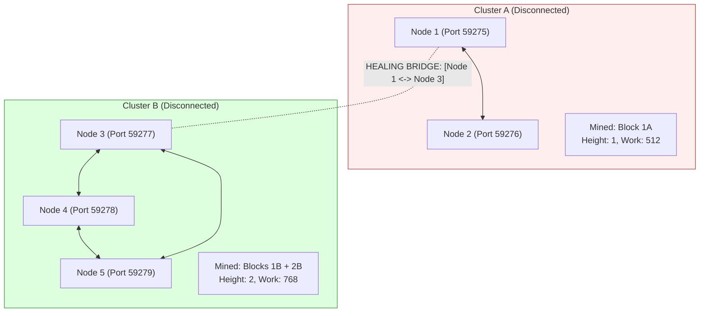

# Assignment 6: A Peer-to-Peer Mempool and Block Relay Network (`p2p`)

**Course**: Practical Blockchain Engineering (Dr. Mayank Agarwal, IIT Patna)  
**Student Name**: Navaneeth Nalla  
**Student Roll**: `2301AI14`  
**Webmail**: `navaneeth_2301ai14@iitp.ac.in`  
**Package**: `p2p`  

---

## 1. Overview & Purpose

A blockchain is fundamentally a peer-to-peer distributed system operating over asynchronous and adversarial channels. Nodes communicate without central coordination, handle network partitions, prevent denial-of-service attacks, manage temporary chain splits (forks), and synchronize state through inventory gossip.

This assignment implements an asynchronous P2P network layer (`p2p`) connecting multiple node instances over localhost TCP using Python's `asyncio`. It includes:
- Safe message framing with a 4-byte big-endian length prefix and a strict 1 MB ceiling.
- An inventory-first gossip protocol (`inv` $\to$ `getdata` $\to$ `tx` / `block`).
- A mempool featuring fee-rate prioritization, duplicate suppression, in-mempool double-spend protection, and stale transaction resurrection.
- Token-bucket rate limiting and peer reputation scoring.
- An automated 5-node partition, divergent mining, and healing convergence experiment.
- Structured JSON logging.

---

## 2. Protocol Specification & Message Framing

Every message is transmitted across TCP using strict length-prefixed framing:
```
+-------------------------------------------------------------+
| Length Prefix (4 bytes, uint32 big-endian) | JSON Payload   |
+-------------------------------------------------------------+
```
- **Size Cap**: Maximum payload size is **1 MB (`1,048,576` bytes)**. Frames declaring lengths $> 1\text{ MB}$ are rejected immediately before reading into memory, preventing memory exhaustion attacks.

### Message Types:
| Message Type | Direction | Payload Schema | Purpose |
|---|---|---|---|
| `handshake` | Bidirectional | `{"node_id": str, "listen_port": int, "best_height": int, "best_work": int}` | Initial peer capability exchange |
| `ping` / `pong` | Bidirectional | `{"nonce": int}` | Keepalive and latency measurement |
| `inv` | Outbound broadcast | `{"inventory": [{"type": "tx"\|"block", "id": "<hash>"}]}` | Inventory announcement |
| `getdata` | Inbound request | `{"inventory": [{"type": "tx"\|"block", "id": "<hash>"}]}` | Request for unknown objects |
| `tx` | Reply to `getdata` | `{"tx_data": {...}}` | Broadcast of serialized transaction |
| `block` | Reply to `getdata` | `{"block_data": {...}}` | Broadcast of serialized block |
| `error` | Diagnostic | `{"code": str, "message": str}` | Protocol error notifications |

---

## 3. Mempool Policy & Transaction Lifecycle

1. **Validation**: Unconfirmed transactions are verified against the current confirmed UTXO set.
2. **In-Mempool Double-Spend Conflict Detection**: The mempool tracks an index of spent OutPoints (`spent_outpoints`). Any incoming transaction spending an OutPoint already claimed by an unconfirmed transaction in the mempool is rejected with `REJECT_MEMPOOL_CONFLICT`.
3. **Fee-Rate Prioritization**: For block template generation, transactions are sorted in descending order of fee-rate:
   $$\text{Fee-Rate} = \frac{\text{Fee (atomic units)}}{\text{Serialized Size (bytes)}}$$
4. **TTL Expiry**: Transactions older than `300` seconds are automatically purged.
5. **Transaction Resurrection**: When a block is disconnected during a chain reorganisation, all valid, non-conflicting transactions from the stale block are resurrected back to the mempool for future inclusion.

---

## 4. Resilience & Denial of Service Protection

- **Token Bucket Rate Limiting**: Each peer connection is guarded by an individual token bucket (`capacity=30`, `refill_rate=15` tokens/sec).
- **Reputation Scoring**: Peers start with 100 reputation points:
  - Exceeding rate limit: $-10$ points.
  - Sending malformed framing / JSON: $-20$ points.
  - Sending invalid blocks: $-25$ points.
  - When reputation $\le 0$, the peer is disconnected and permanently added to `banned_peer_ids`.

---

## 5. Five-Node Partition & Convergence Experiment



### Experiment Trace:
1. **Partition Setup**: Five nodes (`Node1` through `Node5`) are launched on localhost. Disconnected clusters are formed:
   - Cluster A: `[Node1, Node2]`
   - Cluster B: `[Node3, Node4, Node5]`
2. **Divergent Mining**:
   - Cluster A mines Block 1A ($\text{Height}=1, \text{Cumulative Work}=512$).
   - Cluster B mines Block 1B and Block 2B ($\text{Height}=2, \text{Cumulative Work}=768$).
3. **Partition Healing**:
   - A bridge connection is created between Node 1 and Node 3.
   - Node 3 gossips `inv` containing Blocks 1B and 2B.
   - Node 1 requests, validates, detects higher cumulative work, triggers chain reorganisation, and forwards inventory to Node 2.
4. **Final Convergence**:
   - All 5 nodes converge on Block 2B (`007af171c13ff551...`) at Height 2 with cumulative work 768!

---

## 6. Structured JSON Logs Sample

Each node produces machine-readable JSON logs for auditability:

```json
{"timestamp": 1794573249.8812, "node_id": "Node1", "peer_id": "", "object_id": "003c43f4ffc3af81ca99871760f23f35b3031198e47fb8a982e67a6073a8d27e", "event": "LOCAL_BLOCK_MINED"}
{"timestamp": 1794573251.1947, "node_id": "Node1", "peer_id": "Node3", "object_id": "005f15886a558d9b50d9f398989a0bc76eaeecf9188da1233969ba80efd9a15d", "event": "BLOCK_RECEIVED"}
{"timestamp": 1794573251.1948, "node_id": "Node1", "peer_id": "", "object_id": "005f15886a558d9b50d9f398989a0bc76eaeecf9188da1233969ba80efd9a15d", "event": "BLOCK_ACCEPTED"}
{"timestamp": 1794573251.1949, "node_id": "Node1", "peer_id": "Node3", "object_id": "007af171c13ff5512717880a93c8f74f16046b3e16b04d6711aeceb03909c8f9", "event": "BLOCK_RECEIVED"}
{"timestamp": 1794573251.1950, "node_id": "Node1", "peer_id": "", "object_id": "007af171c13ff5512717880a93c8f74f16046b3e16b04d6711aeceb03909c8f9", "event": "BLOCK_ACCEPTED"}
```

---

## 7. Running the Partition Experiment & Tests

### Run 5-Node Partition Simulation:
```bash
p2p simulate-partition
```

### Run Unit Tests:
```bash
pytest -v
```
All **10 tests** pass covering message framing, rate limiting, mempool conflict handling, TTL expiration, two-node block gossip, and 5-node partition convergence.

