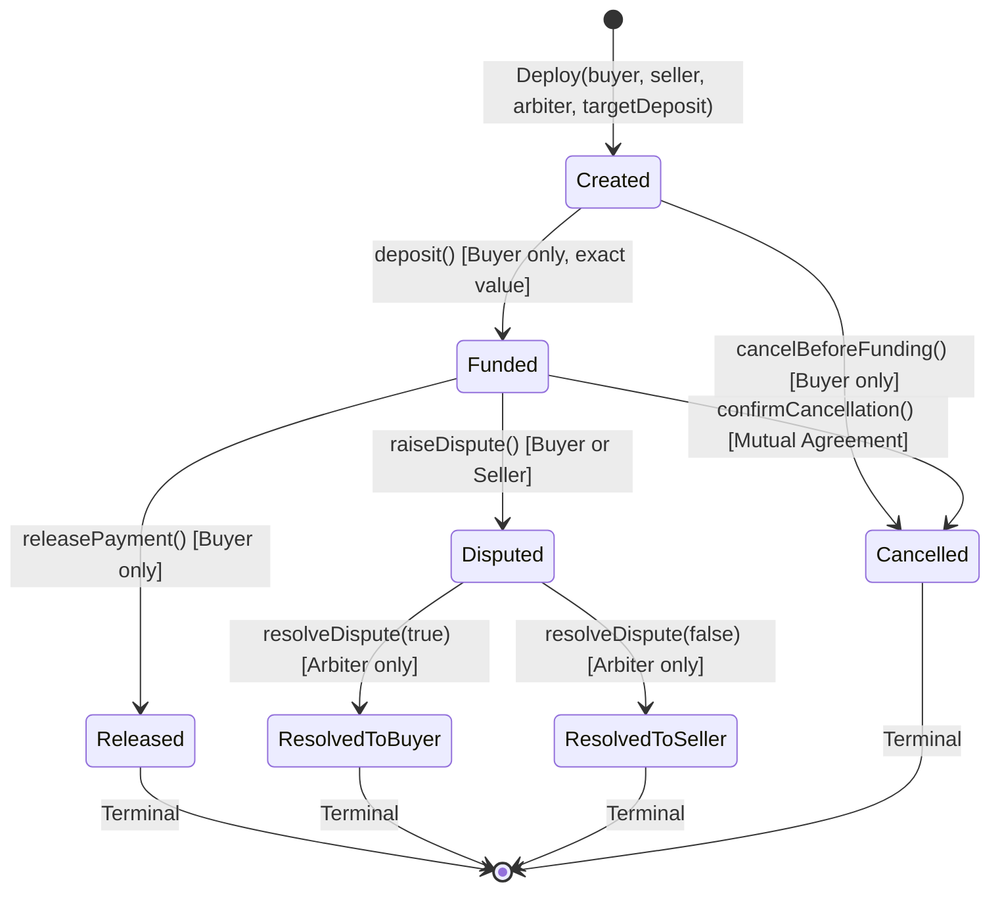

# Assignment 7: Solidity Escrow from Specification to Deployment

**Course**: Practical Blockchain Engineering (Dr. Mayank Agarwal, IIT Patna)  
**Student Roll**: `2301AI14`  
**Contract**: `Escrow.sol`  

---

## 1. Formal Contract Specification

### A. Roles & Parameters (Immutable)
- **`buyer`**: The funding party who deposits Ether and holds unilateral authority to release payment upon satisfactory delivery.
- **`seller`**: The counterparty recipient who delivers goods/services and claims payment upon release or favorable dispute resolution.
- **`arbiter`**: A trusted, neutral third-party resolver with sole authority to resolve active disputes.
- **`targetDeposit`**: Fixed amount of Wei required to fund the escrow contract.

### B. Core Guardrails & Invariants
1. **Zero-Address Prohibition**: $\text{buyer} \ne 0$, $\text{seller} \ne 0$, $\text{arbiter} \ne 0$.
2. **Role Isolation**: $\text{buyer} \ne \text{seller}$, $\text{arbiter} \ne \text{buyer}$, $\text{arbiter} \ne \text{seller}$.
3. **Solvency Invariant**: At all times:
   $$\text{address}(\text{this}).\text{balance} == \text{totalLiabilities}$$
4. **Pull-Over-Push Payments**: External ETH transfers occur solely when the beneficiary explicitly calls `withdraw()`. Beneficiary contract reverts cannot revert or DoS state transitions.
5. **Terminal State Immutability**: States `Released`, `ResolvedToBuyer`, `ResolvedToSeller`, and `Cancelled` are terminal. No further state transitions or repeated payments can occur.

---

## 2. State Machine Specification

| State | Permitted Transitions | Trigger / Authority |
|---|---|---|
| **`Created`** | $\to$ `Funded`<br>$\to$ `Cancelled` | `buyer` deposits exact `targetDeposit`<br>`buyer` cancels prior to funding |
| **`Funded`** | $\to$ `Released`<br>$\to$ `Disputed`<br>$\to$ `Cancelled` | `buyer` calls `releasePayment()`<br>`buyer` or `seller` calls `raiseDispute()`<br>Mutual agreement (`requestCancellation` + `confirmCancellation`) |
| **`Disputed`** | $\to$ `ResolvedToBuyer`<br>$\to$ `ResolvedToSeller` | `arbiter` calls `resolveDispute(true)`<br>`arbiter` calls `resolveDispute(false)` |
| **Terminal** | *None* | No further transitions permitted |

### State Transition Diagram (Mermaid)



---

## 3. Security Threat Model & Mitigations

| Threat | Attack Vector | Contract Mitigation |
|---|---|---|
| **Reentrancy** | Malicious seller fallback attempts to re-enter `withdraw()` before balance is zeroed. | Strict **Checks-Effects-Interactions (CEI)** pattern zeroes `withdrawableFunds` before making external `.call{value}()`. Reinforced with `nonReentrant` mutex guard. |
| **DoS with Failed Call** | A malicious receiver contract reverts on ETH transfer, freezing contract execution. | **Pull-over-push pattern**: funds are credited to `withdrawableFunds[recipient]`. State transitions never perform external raw calls. If a receiver reverts, only their own withdrawal fails. |
| **Unauthorized Transitions** | Malicious actor attempts to release payment or rule on dispute. | Custom error `UnauthorizedCaller(msg.sender)` enforced via `onlyBuyer`, `onlySeller`, and `onlyArbiter` function modifiers. |
| **Unilateral Fund Theft** | Seller tries to cancel and take funds, or buyer tries to cancel after shipment. | Once `Funded`, cancellation requires **two-step mutual agreement** (`requestCancellation` by one party, `confirmCancellation` by counterparty). Counterparty self-confirmation is rejected. |
| **Overfunding / Underfunding** | Buyer deposits incorrect ETH value or attempts repeated deposits. | `deposit()` strictly checks `msg.value == targetDeposit` and reverts with `DepositAmountMismatch` or `InvalidState`. |

---

## 4. Local Deployment & Interaction Receipts

Execution trace from local Hardhat node (`scripts/deploy_and_interact.js`):

```
================================================================================
ESCROW SMART CONTRACT DEPLOYMENT & INTERACTION SCRIPT
================================================================================
Deployer Address: 0xf39Fd6e51aad88F6F4ce6aB8827279cffFb92266
Buyer Address:    0x70997970C51812dc3A010C7d01b50e0d17dc79C8
Seller Address:   0x3C44CdDdB6a900fa2b585dd299e03d12FA4293BC
Arbiter Address:  0x90F79bf6EB2c4f870365E785982E1f101E93b906
Escrow Deposit:   2.0 ETH

--- 1. DEPLOYING ESCROW CONTRACT ---
Deployed Contract Address: 0x5FbDB2315678afecb367f032d93F642f64180aa3
Deployment Tx Hash:        0x1c4eecf56a87f24f2c34a641519b0d53e609b43da009f0b392e9a3dffac3deba
Deployment Gas Used:       965331
Contract Initial State:    0 (Created)
Contract Initial Balance:  0.0 ETH

--- 2. BUYER DEPOSITS 2.0 ETH ---
Deposit Tx Hash:   0x013873c5dd04f82ee9f8f1f06e2e8c8b07c963c73717e129a2d45b50586fa569
Deposit Gas Used:  67202
Current State:     1 (Funded)
Contract Balance:  2.0 ETH
Solvency Verified: true

--- 3. BUYER RELEASES PAYMENT TO SELLER ---
Release Tx Hash:   0x6c07b7482ec088a31713c4b72605e18b5d45e9be16a2d48b73ec56b4ab17fd0c
Release Gas Used:  50228
Current State:     2 (Released)
Seller Pending:    2.0 ETH
Solvency Verified: true

--- 4. SELLER EXECUTES PULL PAYMENT WITHDRAWAL ---
Withdraw Tx Hash:  0xf2ba548c48466a77e1b178bbdbf9e6b8051a418c1ef4c594a793dd1a4267fbd1
Withdraw Gas Used: 36053
Seller Delta ETH:  +2.0 ETH (before gas)
Contract Final Bal:0.0 ETH
Contract Total Liab:0.0 ETH
Solvency Verified: true
================================================================================
```

### Gas Report Summary Table:

| Contract Operation | Gas Used | Execution Context |
|---|---|---|
| **Contract Deployment** | 965,331 gas | Constructor deployment with role configuration |
| **Buyer Deposit (2.0 ETH)** | 67,202 gas | State transition `Created` $\to$ `Funded` + liability accounting |
| **Buyer Payment Release** | 50,228 gas | State transition `Funded` $\to$ `Released` + credit seller |
| **Seller Pull Withdrawal** | 36,053 gas | Balance zeroing + external raw call |

---

## 5. Running Tests & Deployment Script

### Run Full Test Suite (Unit & Fuzz Tests):
```bash
npm test
```
**Test Results:**
```
  23 passing (829ms)
```

### Run Deployment & Interaction Script:
```bash
npm run deploy
```

